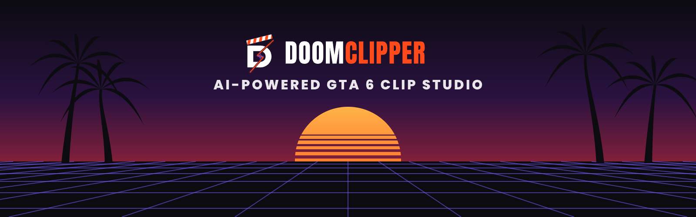
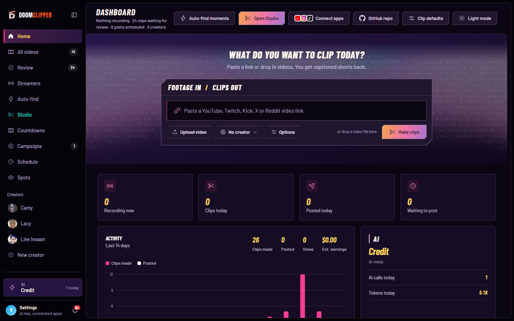
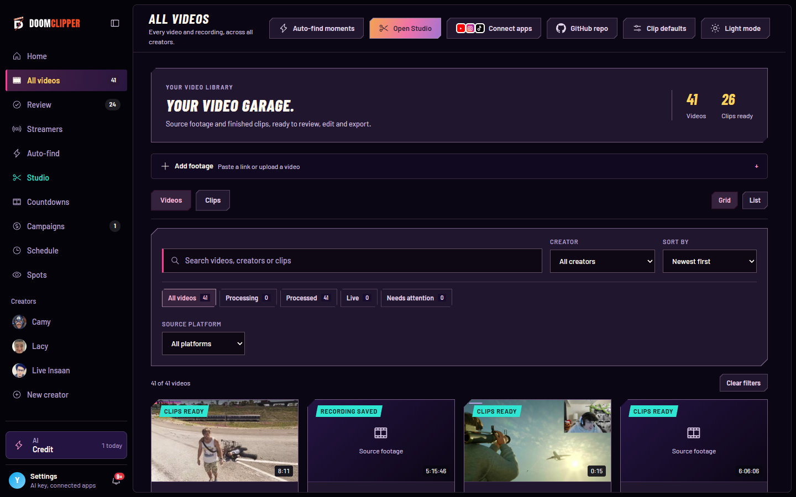
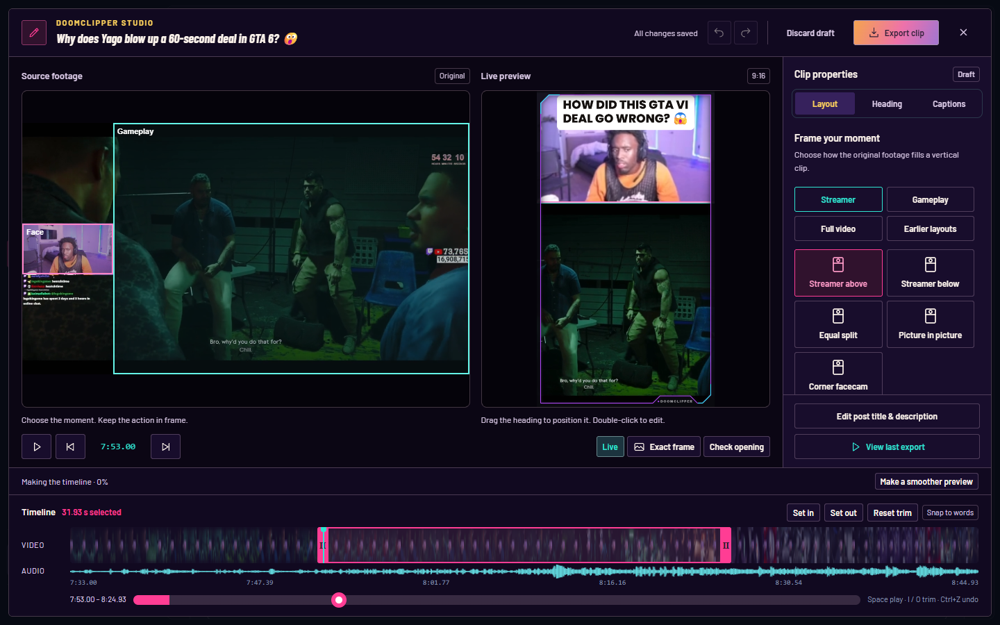
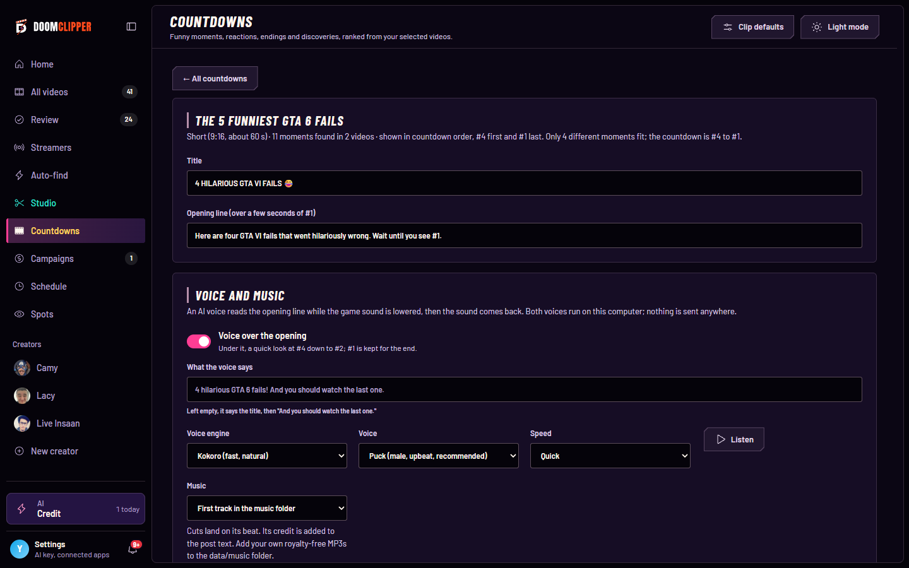
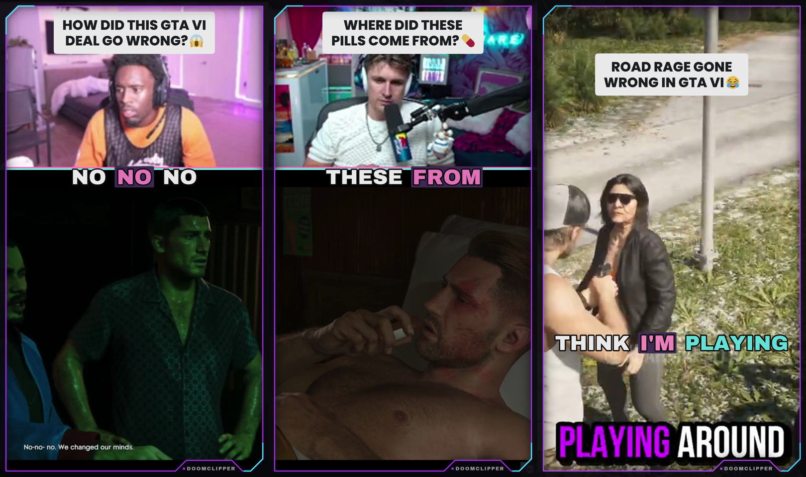
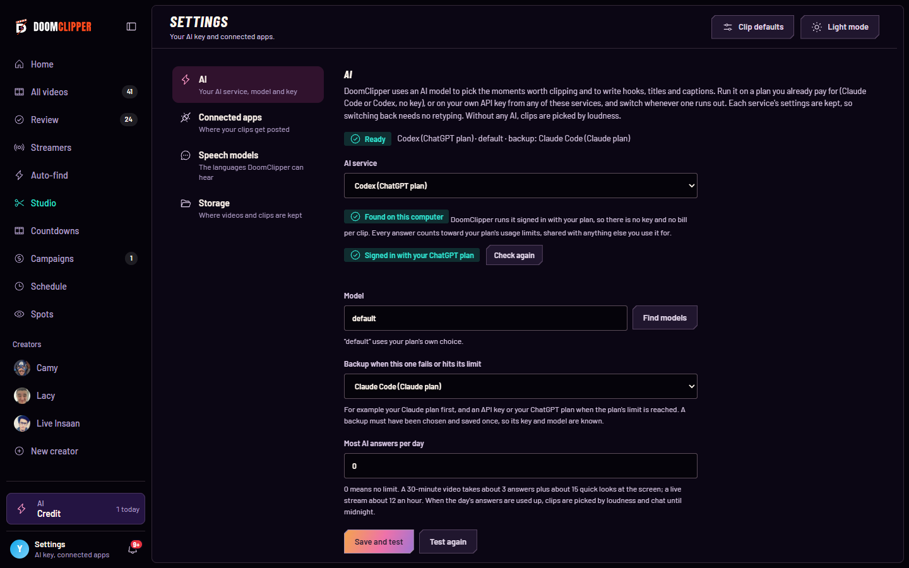

# Doomclipper Release

<b>Turn long GTA 6 streams and videos into captioned vertical clips, automatically.</b> 
Windows app · runs on your own computer · uses your Claude or ChatGPT plan, or an API key

<a href="../../releases/latest"><b>⬇ Download the latest version</b></a>

---

## What it does

Paste a YouTube, Twitch, Kick, X or Reddit link (or drop in a video file). DoomClipper downloads it, writes the
transcript on your computer, has an AI pick the moments worth clipping, and makes each one a finished 9:16 short:
the streamer's face on top, the game below, word-by-word captions, a heading with emoji, a branded frame and an end
card. It can also record live streams and clip them as they happen, and build "Top 5" countdown videos with a voice-over
and music.

| | |
|---|---|
| **Clips from any video** | YouTube, Twitch, Kick, X (Twitter), Reddit, Streamable, Medal, or your own files |
| **Face + game layout** | The webcam is found automatically; streamer on top, game below, or picture-in-picture |
| **Captions** | Word-by-word, in styles like Vice City, Marker and Karaoke; fix any word in Studio |
| **Countdowns** | "Top 5" videos from several sources, with an AI voice-over and royalty-free music |
| **Live recording** | Records a stream and clips the best moments as they happen; mark a moment by hand |
| **Studio** | Trim, reposition, restyle and export one clip, with an exact preview |
| **Posting** | Review queue and scheduled posting to YouTube, TikTok and Instagram (your accounts) |

## Screenshots

| Dashboard | Video library |
|---|---|
|  |  |

| Studio | Countdowns |
|---|---|
|  |  |

| A finished clip | AI settings |
|---|---|
|  |  |

## Install

1. **Download** `DoomClipper-Setup-<version>.exe` from [Releases](../../releases/latest) (about 150 MB).
2. **Run it.** It installs for your Windows user only, so no administrator prompt. Windows SmartScreen may say
   "Windows protected your PC" because the installer is new and not yet widely downloaded: click **More info**, then
   **Run anyway**.
3. **Let it finish its downloads.** At the end, "Getting DoomClipper ready" downloads the English speech model and the
   AI voice (about 830 MB, once), each with a progress bar. If you untick this step, or the internet drops, DoomClipper
   downloads them the first time it needs them instead.
4. **Start DoomClipper** from the Start menu or the desktop. A small window opens and keeps DoomClipper running; the
   dashboard opens in your browser. Keep that small window open while you clip; closing it stops DoomClipper.

**Needs:** Windows 10 or 11 (64-bit), about 2 GB free for the app and models, plus room for your videos. A graphics
card is not required (AMD, Intel and NVIDIA encoders are used when present). Everything else, including ffmpeg, comes
with it.

## Connect an AI

DoomClipper uses an AI to pick moments and write titles. Open **Settings → AI** and choose one:

- **Your Claude plan (Claude Code)** or **your ChatGPT plan (Codex)**: no key and no bill per clip; answers count
  toward your plan's usage. Install the app if you haven't
  ([Claude Code](https://claude.com/claude-code): in PowerShell, `irm https://claude.ai/install.ps1 | iex`;
  [Codex](https://developers.openai.com/codex/cli): `npm install -g @openai/codex`), then press
  **Sign in with your plan**. Its own sign-in opens in your browser; DoomClipper never sees your password. The page
  shows "Signed in with your plan" when it worked.
- **An API key** from Gemini, OpenAI, Claude, Grok, Groq or OpenRouter, or a local model with Ollama.

Set a **backup** so that when one plan hits its limit, the other takes over. **Save and test** tries the backup too
and tells you which one answered. Without any AI, clips are still found, by loudness and chat.

## Connect live streams, posting and alerts

Everything is in **Settings → Connected apps**, each with step-by-step instructions on the page:

| What | Why | What you need |
|---|---|---|
| **Twitch** | List who's live on Twitch on the Streamers page | A free Twitch developer app (Client ID and Secret, about 2 minutes) |
| YouTube and Kick live streams | Listed and recorded | Nothing: no key needed |
| **YouTube**, **Instagram**, **TikTok** | Post clips to your accounts | Press Connect and sign in on the platform's own page |
| **YouTube cookies** | Only if YouTube refuses downloads from your connection | A cookies file from your browser |
| **Alerts on your phone** | A message when a recording starts or fails, a clip is ready or a post fails, plus a daily summary | A Discord webhook link, or a Telegram bot token and chat id; press **Send a test message** |

## How to use it

1. **Paste a link** on the dashboard, or upload a video, and press **Make clips**. Watch progress in **All videos**.
2. **Review** the clips: approve, re-make, or open one in **Studio** to trim it, move the heading, change the layout or
   captions, fix a word, then **Export clip**.
3. **Countdowns:** pick a topic (175 ideas, like "shooting down planes"), search YouTube for sources, tick them, and
   DoomClipper finds and ranks the moments. Check the storyboard, then make the Short.
4. **Live:** add a streamer under **Streamers** and record; mark a moment with **Mark start / End mark**, or take the
   **Best moment** of the last 3 minutes.
5. **Post:** connect YouTube, TikTok or Instagram under **Settings → Connected apps**, or download the clips.

Your videos, clips and settings are kept in `%LOCALAPPDATA%\DoomClipper` (change it in **Settings → Storage**).
Updating or uninstalling the app never deletes them.

## Use it responsibly

Clips of other people's streams and videos belong to them. Get the creator's permission before posting their content
(DoomClipper keeps posting off for a creator until you record their permission), credit them, and follow each
platform's rules. DoomClipper does not hide where a clip came from or change it to look like original work.

## Troubleshooting

| Problem | What to do |
|---|---|
| "Windows protected your PC" | **More info → Run anyway** (the installer is new, not signed by a large publisher) |
| The dashboard doesn't open | Click **Open dashboard** in the small DoomClipper window; or **Open logs** to see why |
| "Not signed in" for Claude Code / Codex | **Settings → AI → Sign in with your plan**, finish in the browser, then **Save and test** |
| The speech model is still downloading | Wait for it (about 480 MB, once); clips start as soon as it's done |
| Your plan hit its limit | Set a backup AI in **Settings → AI**; DoomClipper switches by itself |
| Uninstall | Windows Settings → Apps → DoomClipper → Uninstall. Your data stays in `%LOCALAPPDATA%\DoomClipper` |

## Licence and credits

DoomClipper is MIT licensed ([LICENSE](LICENSE)). The installer includes ffmpeg (GPL v3, from gyan.dev's essentials
build), the Anton, Archivo Black and Poppins fonts (SIL OFL), Twemoji (CC-BY 4.0) and four tracks by Kevin MacLeod
(incompetech.com, CC-BY 4.0). It downloads NVIDIA's Parakeet speech model (CC-BY-4.0) and the Kokoro voice (Apache 2.0)
when installing. The full list, with every bundled library's licence and ffmpeg's source link, is in
[THIRD-PARTY-NOTICES.txt](THIRD-PARTY-NOTICES.txt) and inside the app's folder.

DoomClipper builds on [PeakCut](https://github.com/haziqahmedqasmi/PeakCut) by haziqahmedqasmi and contributors (MIT).
